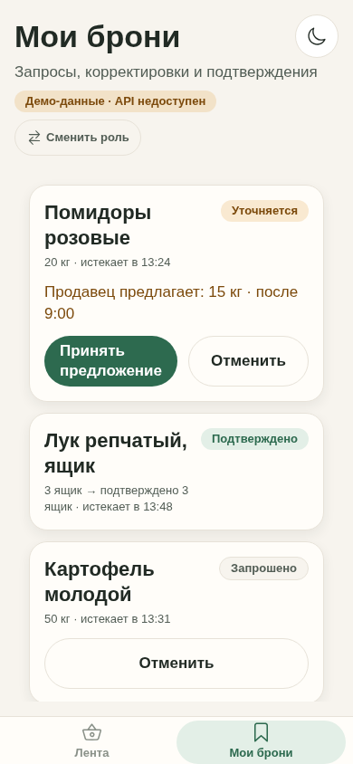
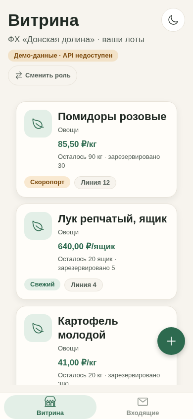
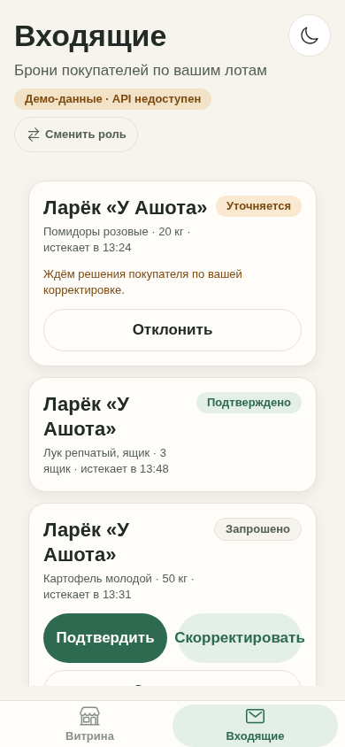
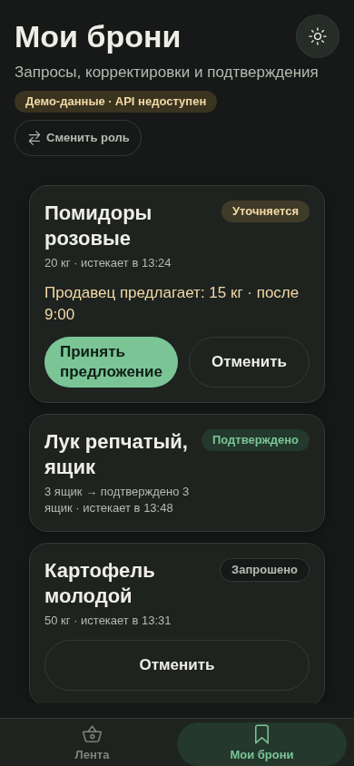
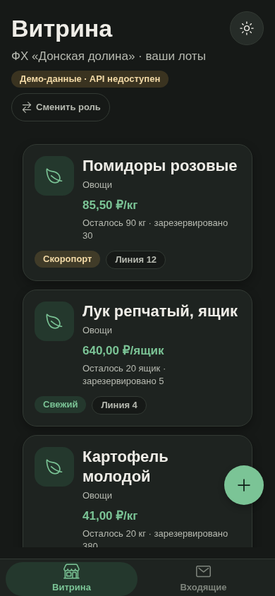
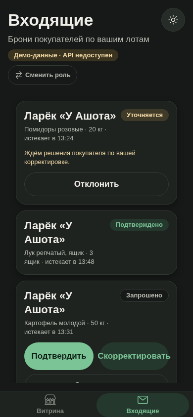

# АгроМолл

[](package.json)
[](https://github.com/bolqor83-crypto/agromoll/actions/workflows/ci.yml)

Мобильное приложение для оптово-розничного рынка «Агро Молл» (Ростов-на-Дону).
**Текущий этап — v0.2.0 «Бронирование»**: модель данных и полный флоу брони
(запрос → корректировка → подтверждение), лента товаров, витрина продавца,
визуальная полировка (skeleton-загрузка, пустые состояния, tab-bar).
Долги, учёт часов, доставка и оплата — на следующих этапах.

> ⚠️ **Аутентификация пока — заглушка**: клиент передаёт заголовок
> `X-User-Id`, роль берётся из БД (подделать нельзя, но перехватить id — можно).
> Настоящий вход (телефон + JWT) появится на следующем этапе — см.
> [ADR-004](docs/adr/ADR-004-booking-model.md).

## Что нового в v0.2.0

- **Модель бронирования** (Prisma): `User` + профиль, `Listing`,
  `Booking`, `BookingEvent` (append-only журнал — будущая репутация);
  миграция `20261105120000_booking_model` — [ADR-004](docs/adr/ADR-004-booking-model.md).
- **API листингов**: `POST /listings` (seller), `GET /listings` (лента с
  фильтрами category/status/lineNumber), `GET /listings/mine`,
  `PATCH /listings/:id` (владелец).
- **API броней**: `POST /bookings` (buyer), `GET /bookings` (свои/входящие),
  `counter-offer` / `accept-counter` / `confirm` / `cancel` — строгая
  машина состояний, атомарный резерв `quantityReserved` (перепродажа
  исключена на уровне БД), TTL 30 минут с cron-гашением, structured-логи
  pino на каждом переходе.
- **Валидация**: zod-схемы listings/bookings в `@agromoll/validation`
  (единый источник для API и будущего клиента).
- **UI v0.2.0** — [ADR-005](docs/adr/ADR-005-visual-components.md):
  `Skeleton` (мерцающий плейсхолдер, не спиннер), `EmptyState` (мягкие
  геометрические иллюстрации), `Icon` (Ionicons outline, 24 px),
  `TabBar` (pill-индикатор, spring-переезды), `PullToRefreshScrollView`
  (зелёный вращающийся круг).
- **Мобильное приложение**: вход по роли → свои вкладки. Покупатель:
  «Лента» (карточки с бейджами Свежий/Скоропорт/Линия N, skeleton, пустые
  состояния) и «Мои брони» (статусы-пилюли, «Принять предложение»/«Отменить»).
  Продавец: «Витрина» (остатки/резервы, FAB «+ Выставить лот») и «Входящие»
  (подтвердить/скорректировать/отклонить). Доставщик: «Радар» и «Мои доставки».
- **Офлайн-фолбэк**: без API экраны показывают демо-данные с честным
  янтарным бейджем «Демо-данные».
- **Тесты**: 84 unit (api + mobile + пакеты) и 5 e2e против реального
  Postgres+PostGIS (service-контейнер в CI): полный флоу брони,
  запрещённые переходы (401/403/409), истечение TTL, целостность резерва.

### Скриншоты v0.2.0 (светлая + тёмная тема)

| Лента покупателя                                          | Мои брони                                                     | Витрина продавца                                                | Входящие                                                      |
| --------------------------------------------------------- | ------------------------------------------------------------- | --------------------------------------------------------------- | ------------------------------------------------------------- |
|  |  |  |  |
|    |    |    |    |

Ещё: [пустая лента (EmptyState)](docs/design/screenshots/light-feed-empty.png).

## Стек

| Слой     | Технологии                                                                                                   |
| -------- | ------------------------------------------------------------------------------------------------------------ |
| Mobile   | React Native (Expo SDK 52), Expo Router 4, TypeScript, Zustand, Reanimated 3, react-native-safe-area-context |
| API      | NestJS 11, TypeScript, Prisma 6, pino (структурированные логи), @nestjs/schedule (cron TTL)                  |
| БД       | PostgreSQL 16 + PostGIS 3.4, Redis 7 (заложен, пока не используется)                                         |
| Монорепо | pnpm workspaces + Turborepo, ESLint 9, Prettier, GitHub Actions                                              |
| Пакеты   | `packages/types` (общие типы), `packages/validation` (zod), `packages/ui` (дизайн-система)                   |

## Структура

```
agromoll/
  apps/
    mobile/          — Expo-приложение: вход по роли → табы разделов
                       (Покупатель: Лента/Мои брони; Продавец: Витрина/Входящие;
                        Доставщик: Радар/Мои доставки) + детальный экран лота
    api/             — NestJS: /health, /listings, /bookings, cron TTL, Prisma
  packages/
    ui/              — дизайн-система: токены, темы, Button, Card, Input, Badge,
                       Screen, Text, Icon, Skeleton, EmptyState, TabBar,
                       PullToRefreshScrollView
    types/           — общие типы (роли, листинги, брони, демо-аккаунты)
    validation/      — zod-схемы (listings, bookings, ENV)
  docs/
    adr/             — ADR-001..005
    design/          — палитра и скриншоты (светлая/тёмная)
  docker-compose.yml — PostgreSQL + PostGIS, Redis
  turbo.json
  pnpm-workspace.yaml
```

## Быстрый старт

### Требования

- Node.js ≥ 20
- pnpm ≥ 9 (`corepack enable` или `npm i -g pnpm`)
- Docker (для БД; на CI проверяется автоматически)

### Запуск с нуля

```bash
# 1. Клонировать и установить зависимости
git clone https://github.com/bolqor83-crypto/agromoll.git
cd agromoll
pnpm install

# 2. Поднять PostgreSQL + PostGIS и Redis
docker compose up -d --wait

# 3. Скопировать переменные окружения
cp .env.example .env                  # токены и URL (в .gitignore)
cp apps/api/.env.example apps/api/.env

# 4. Сгенерировать Prisma-клиент и применить миграции
pnpm db:generate
pnpm db:migrate

# 5. Засеять демо-аккаунты и витрину (id для X-User-Id)
pnpm --filter @agromoll/api db:seed

# 6. Собрать пакеты (types, validation, ui)
pnpm build

# 7. Запустить всё
pnpm dev
```

После запуска:

- API: `http://localhost:3000/health` — healthcheck
- Mobile (Expo): `http://localhost:8081` — Metro-сервер (w — web, a — Android, i — iOS)

### Как потрогать флоу брони вручную

```bash
SELLER=00000000-0000-4000-8000-000000000002   # ФХ «Донская долина» (из сида)
BUYER=00000000-0000-4000-8000-000000000001    # Ларёк «У Ашота» (из сида)

# 1. Покупатель смотрит ленту
curl -s http://localhost:3000/listings | head -c 400

# 2. Покупатель бронирует (listingId взять из ленты)
curl -s -X POST http://localhost:3000/bookings \
  -H "Content-Type: application/json" -H "X-User-Id: $BUYER" \
  -d '{"listingId": "<LISTING_ID>", "requestedQuantity": 20}'

# 3. Продавец предлагает корректировку: 15 кг после 9:00
curl -s -X POST http://localhost:3000/bookings/<BOOKING_ID>/counter-offer \
  -H "Content-Type: application/json" -H "X-User-Id: $SELLER" \
  -d '{"offeredQuantity": 15, "pickupTime": "после 9:00"}'

# 4. Покупатель принимает
curl -s -X POST http://localhost:3000/bookings/<BOOKING_ID>/accept-counter \
  -H "Content-Type: application/json" -H "X-User-Id: $BUYER" -d '{}'
```

Отдельные части:

```bash
pnpm --filter @agromoll/api dev        # только API
pnpm --filter @agromoll/mobile dev     # только mobile
pnpm --filter @agromoll/mobile dev:web # web-версия в браузере
```

### Проверки

```bash
pnpm lint        # ESLint по всем пакетам
pnpm typecheck   # TypeScript по всем пакетам
pnpm test        # unit-тесты (без БД)
pnpm --filter @agromoll/api test:e2e  # e2e против DATABASE_URL (нужна БД)
pnpm build       # сборка пакетов, api и web-экспорт mobile
pnpm format      # Prettier
```

CI (`.github/workflows/ci.yml`):

- **quality** — lint/typecheck/unit/e2e/build; e2e идёт против service-контейнера
  `postgis/postgis:16-3.4` (миграции применяются перед прогоном);
- **stack** — `docker compose` целиком, миграции + проверка `prisma migrate diff`
  (миграции обязаны точно соответствовать `schema.prisma`) + PostGIS/Redis.

## Дизайн-система

Токены и компоненты живут в `packages/ui` (см. [ADR-002](docs/adr/ADR-002-design-system.md)):

- **Философия**: приложение используется в 4 утра, на улице, в спешке и перчатках —
  крупная типографика, тач-зоны от 48×48, минимум текста.
- **Цвета**: тёплый нейтральный фон (не слепит в темноте), тёмно-зелёный акцент,
  мягкий янтарный для срочности. Красный запрещён.
- **Тёмная тема** — с первого дня, следует системе + ручной переключатель на каждом экране.
- **Анимации**: 200–300 мс, spring-отклик на нажатиях (Reanimated), haptics на
  ключевых действиях.

Скриншоты и обоснование палитры: [docs/design/palette.md](docs/design/palette.md).

## Архитектурные решения

| ADR                                              | Тема                                                        |
| ------------------------------------------------ | ----------------------------------------------------------- |
| [ADR-001](docs/adr/ADR-001-tech-stack.md)        | Технологический стек (Expo, NestJS, Prisma, PostGIS, Redis) |
| [ADR-002](docs/adr/ADR-002-design-system.md)     | Дизайн-система: токены, палитра, тёмная тема, тактильность  |
| [ADR-003](docs/adr/ADR-003-monorepo.md)          | Монорепозиторий: pnpm workspaces + Turborepo                |
| [ADR-004](docs/adr/ADR-004-booking-model.md)     | Модель бронирования: статусы, резерв, TTL 30 минут          |
| [ADR-005](docs/adr/ADR-005-visual-components.md) | Визуальные компоненты v0.2.0: Skeleton, EmptyState, TabBar  |

## Ветвление и коммиты

- `main` — стабильная ветка, push только после зелёного CI (через PR).
- `feature/*` — ветки задач.
- Коммиты — [Conventional Commits](https://www.conventionalcommits.org/ru/): `feat:`, `fix:`, `docs:`, `chore:`, `ci:` …

## Что дальше (v0.3.0)

- Аутентификация по номеру телефона (JWT) вместо заглушки X-User-Id
- Outbox-паттерн и офлайн-синхронизация мобильного клиента
- Валидация ответов API на клиенте zod-схемами из @agromoll/validation
- Выкуп брони, долги и учёт часов
- Геозоны рынка (PostGIS), доставка попутчиками
- Redis: очередь событий, rate-limit; EAS Build + expo-updates
