# АгроМолл

[](package.json)
[](https://agromoll-web.vercel.app)
[](https://github.com/bolqor83-crypto/agromoll/actions/workflows/ci.yml)

Мобильное приложение для оптово-розничного рынка «Агро Молл» (Ростов-на-Дону).
**Текущий этап — v0.6.1 «Mobile UX: хотфикс прода + удобство одной руки»**:
бронирование (v0.2.0), аутентификация (v0.3.x), долги и приёмка (v0.4.0),
рейтинг, геозоны и доставка (v0.5.0) — полностью сохранены. Web-версия
деплоится на Vercel: **https://agromoll-web.vercel.app**

## Что нового в v0.6.1

Шесть подэтапов — 0/A/B/C/D/E: хотфикс прода, код-сплиттинг, клавиатура
и тема, primary actions в зоне большого пальца, честная обработка ошибок
и демо-фолбэк, документация и релиз. Приоритет — удобство на телефоне:
лёгкое, быстрое, одной рукой, в перчатках, в 4 утра.

- **Хотфикс прода** —
  [ADR-022](docs/adr/ADR-022-api-url-configuration.md).
  Сборка вне машины разработчика стучалась на `localhost:3000` — приложение
  было мёртвым. Теперь адрес API приходит только из окружения
  `EXPO_PUBLIC_API_URL` (вшивается на сборке): в dev — фолбэк на localhost,
  в prod фолбэка НЕТ — без адреса приложение честно показывает экран
  «Сервер не настроен», а не ходит в никуда. План публикации API —
  [docs/DEPLOY.md](docs/DEPLOY.md).
- **Код-сплиттинг + ленивые экраны** —
  [ADR-023](docs/adr/ADR-023-code-splitting-lazy-load.md).
  Экраны вкладок вынесены в отдельные чанки (React.lazy + Suspense),
  роль грузит только свои экраны, тяжёлые зависимости (камера, геолокация,
  gesture-handler) убраны из entry. Фолбэк — Skeleton-каркас, никаких
  спиннеров. Чанки вкладок прогреваются prefetch'ем при входе в роль.
  Entry: 519 → 443 КБ gzip (−15%), TTI 3710 → 3235 мс (−13%).
- **Клавиатура, тема, листы** —
  [ADR-024](docs/adr/ADR-024-keyboard-theme-persist-sheet-rounding.md).
  KeyboardAvoidingView на всех формах (iOS padding / Android height / web
  без оверлея), выбор темы сохраняется (zustand persist), модальные листы
  со скруглением 20 px сверху, настоящие иконка и заставка приложения
  вместо 79-байтовых заглушек.
- **Primary actions в thumb zone + доступность** —
  [ADR-025](docs/adr/ADR-025-primary-actions-thumb-zone.md).
  «Получить код», «Заказать доставку», «Беру», «Выставить лот» (FAB) —
  в нижней трети экрана, куда достаёт большой палец; иерархия: primary
  зелёная ≥ 56 px / secondary / ghost, destructive — янтарный, не
  красный. Все иконочные кнопки с accessibilityLabel, тач-зоны от 48 px,
  фокус-стили на web.
- **Честная обработка ошибок и демо-фолбэк** —
  [ADR-026](docs/adr/ADR-026-error-handling-honest-demo.md).
  Унифицированный ErrorState в дизайн-системе (full/inline): любая ошибка
  — видимое состояние с кнопкой «Повторить», никаких вечных skeleton
  и молчаливых console.warn. Радар, брони, входящие и доставка — без
  фейковых данных при недоступном API; лента и витрина — демо с
  полноширинным янтарным баннером «Демо-режим. API недоступен. Данные
  не настоящие» и отключёнными серверными кнопками. Единый маппинг
  кодов ошибок в человеческие тексты; stale-данные помечаются, но не
  прячутся; NetInfo-события логируются.
- **Анимации и переходы** —
  [ADR-027](docs/adr/ADR-027-animations-transitions.md).
  Всё на Reanimated 3, 200–300 мс spring, обязательный reduced motion:
  плавные переходы между вкладками (fade+slide 200 мс), морф карточки
  лота в детальный экран (паттерн v0.3.1), тихая галочка успеха
  (400 мс spring + haptic) после брони/подтверждения/погашения долга
  и синхронизации очереди, покачивание полей при ошибках валидации,
  появление ErrorState/EmptyState со stagger-задержкой иллюстрации,
  плавный пробег цифр счётчиков (долги, часы 289-ФЗ, рейтинг).
  FPS скролла не просел (замеры — в ADR-027).

### Метрики до/после

| Метрика                                          | До (v0.5.0)              | После (v0.6.1)     | Δ                |
| ------------------------------------------------ | ------------------------ | ------------------ | ---------------- |
| Entry-чанк gzip                                  | 519 КБ                   | 443 КБ             | **−15%**         |
| TTI (4×CPU + Fast 3G, лог «приложение запущено») | 3710 мс                  | 3235 мс            | **−13%**         |
| TTI против инвентаризации (4,2 с)                | —                        | 3235 мс            | **−23%**         |
| Чанков в бандле                                  | 1 монолит (+2 служебных) | entry + 16 ленивых | экраны по 1–5 КБ |
| FPS скролла ленты (4×CPU)                        | ~54                      | 60 (упор в vsync)  | без регрессии    |

<details><summary>Как замерялось</summary>

- Entry-чанк: `gzip -6` по `dist/_expo/static/js/web/entry-*.js`
  (v0.5.0 — 519 КБ, v0.6.1 — 443 КБ; в середине этапа, до подэтапа D,
  было 437 КБ — ADR-023).
- TTI: Playwright, 4×CPU + Fast 3G, маркер — лог «приложение
  запущено» из RootLayout (ADR-023).
- FPS: Playwright, 4×CPU, окно 390×844, лента с 12 лотами (мок API),
  прокрутка колесом 5 с, медиана 3 прогонов. Обе версии держат
  потолок vsync — просадки от сплиттинга нет.

</details>

### Скриншоты v0.6.1 (светлая / тёмная)

| Ошибка сети: радар — ErrorState с «Повторить»                                | Демо-режим ленты — баннер + отключённые кнопки                        |
| ---------------------------------------------------------------------------- | --------------------------------------------------------------------- |
| 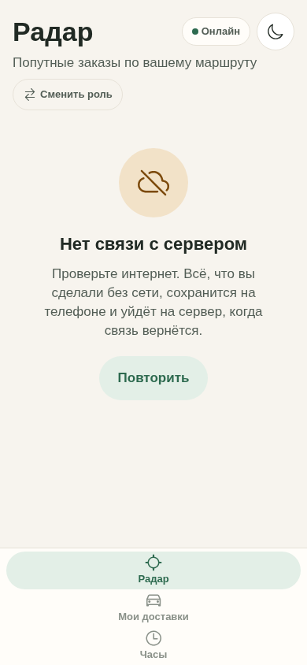 | 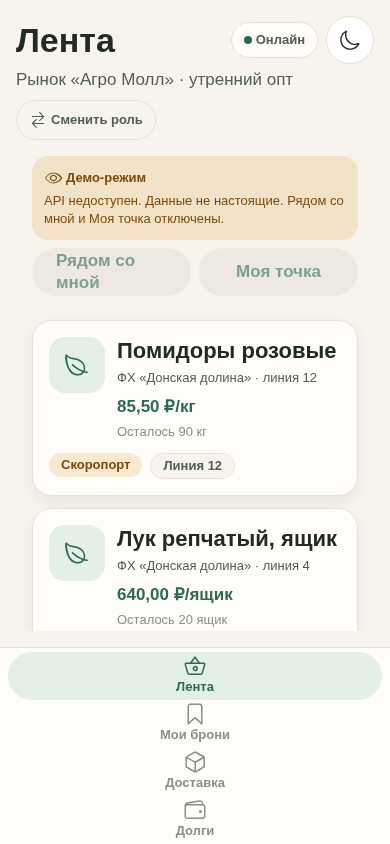 |
| 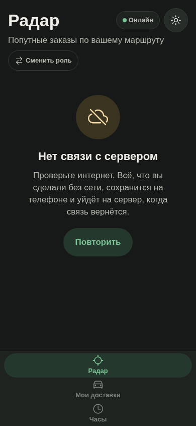   | 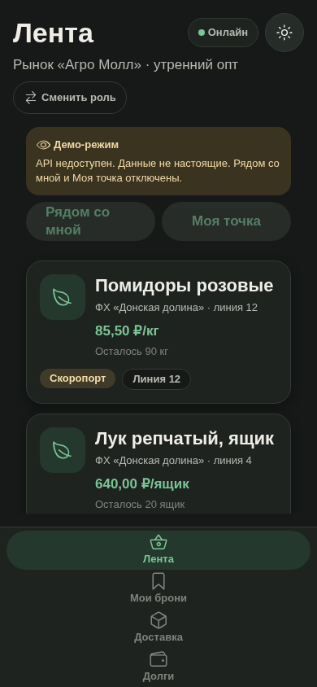   |

| Брони без фейков (вариант A)                                                    | Доставка без фейков (вариант A)                                                    |
| ------------------------------------------------------------------------------- | ---------------------------------------------------------------------------------- |
| 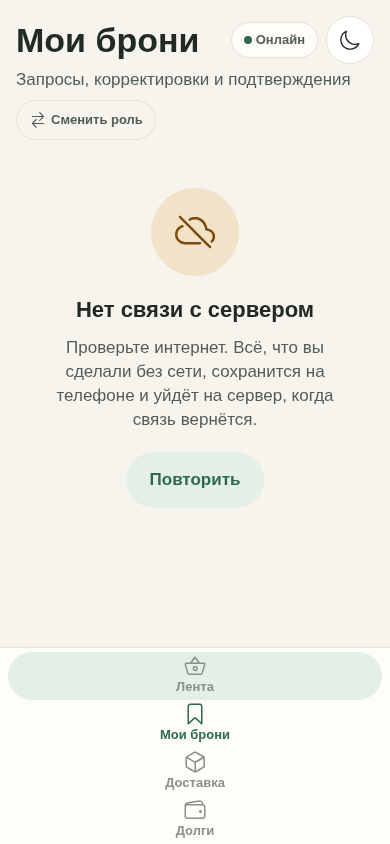 | 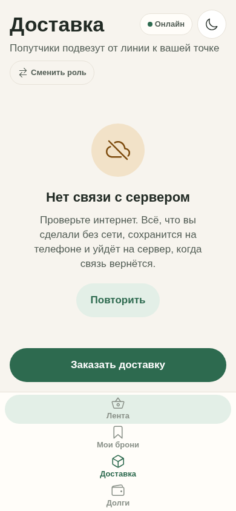 |
| 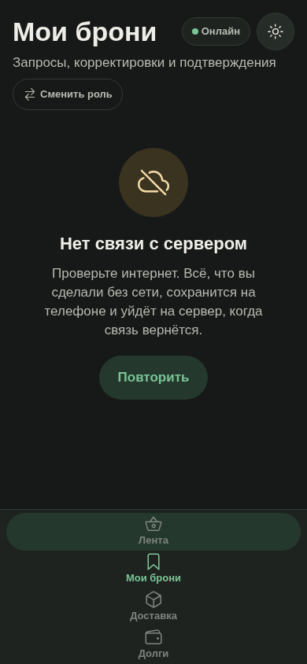   | 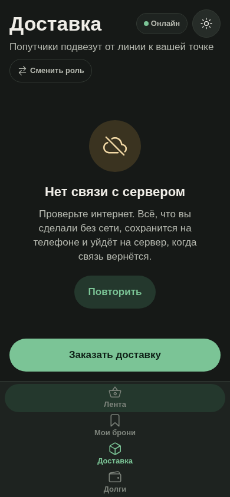   |

| Primary action: вход                                                     | Primary action: доставка                                                         |
| ------------------------------------------------------------------------ | -------------------------------------------------------------------------------- |
| 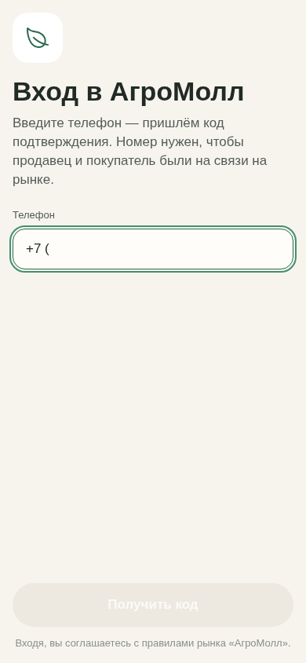 | 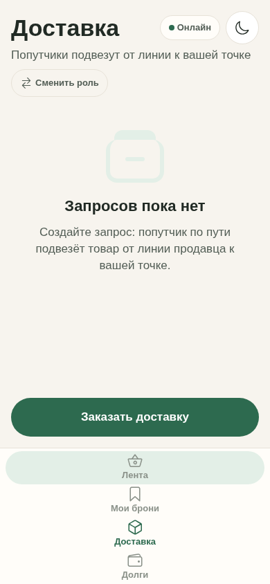 |
| 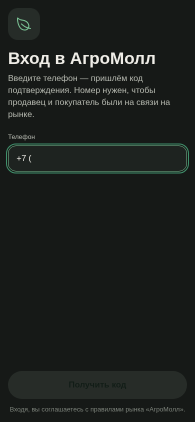   | 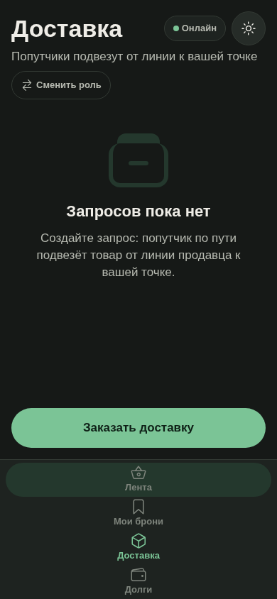   |

| Primary action: радар (sticky «Беру»)                                    | Primary action: витрина (FAB)                                         |
| ------------------------------------------------------------------------ | --------------------------------------------------------------------- |
| 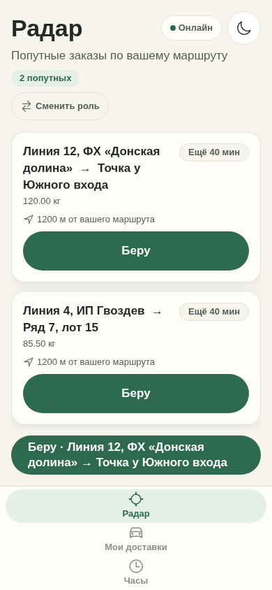 | 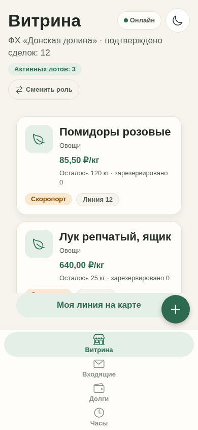 |
| 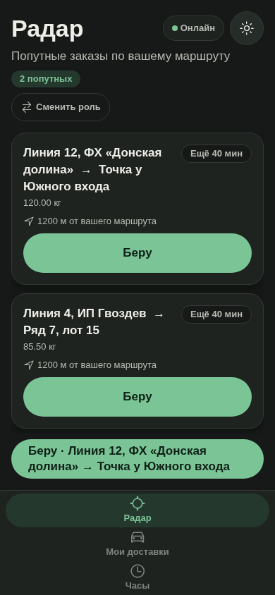   | 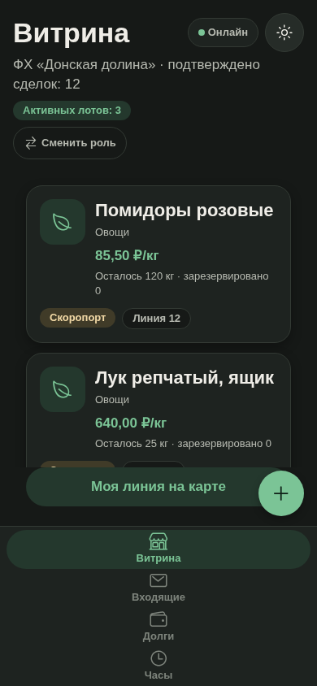   |

| Лист со скруглением 20 px                                                 | Экран «Сервер не настроен» (без env)                                                |
| ------------------------------------------------------------------------- | ----------------------------------------------------------------------------------- |
| 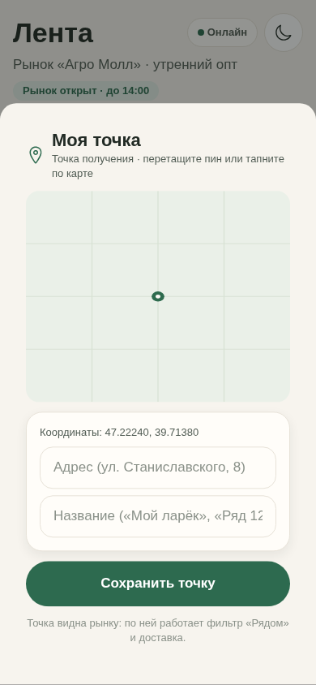 | 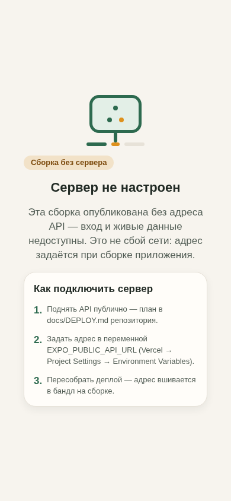 |
| 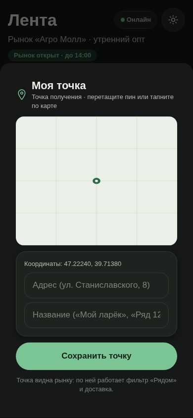   | 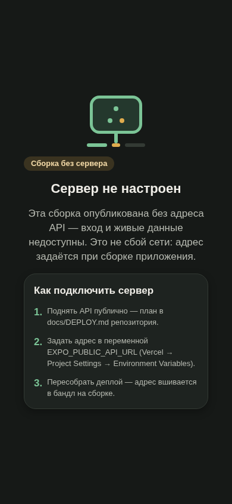   |

Ещё: каскадный вход карточек и Suspense-skeleton (A) —
`docs/screenshots/v0.6.1/A-*.png`, иконка приложения (B) —
`docs/screenshots/v0.6.1/B-app-icon.png`, двухкадровые анимации E2
(переход вкладки, галочка успеха, появление ErrorState — кадр «в
движении» + финал) — `docs/screenshots/v0.6.1/E2-*.png`.

## Что нового в v0.5.0

Четыре подэтапа: доверие (рейтинг), физическая география рынка
(геозоны + PostGIS), попутная логистика (доставка) и web-деплой.

- **Публичный рейтинг** — [ADR-013](docs/adr/ADR-013-public-rating.md).
  Рейтинг 0–5 из append-only журналов сделок и долгов:
  `score = 5×(Σpos−Σneg)/N`; веса ok=1.0 / minor=0.5 / авто=0.3 /
  спор=−1.0 / долг погашен=+1.0 / спор разрешён обоюдно — нейтрален.
  Порог `RATING_MIN_DEALS=5` (меньше — score=null: новичков не
  наказываем), анти-накрутка (>10 сделок пары за 30 дней → вес 0.3).
  `ReputationSnapshot` (снимок) + `ReputationEvent` (аудит);
  пересчёт НЕ блокирует сделку (триггеры после фиксации, самопочинка).
  `GET /reputation/:userId`, `/reputation/me` (прогресс «ещё N сделок»
  - таймлайн); бейджи «4.7 · 42 сделки» на карточках листингов,
    броней и долгов; экран «Мой рейтинг». ENV-веса `RATING_*`.
- **Геозоны (PostGIS)** — [ADR-014](docs/adr/ADR-014-geozones.md).
  `GeoPoint`: точки покупателей, линии продавцов, коридоры
  доставщиков («еду из А в Б»). Координаты — Float + PostGIS
  `geography(Point,4326)` (синхронизация триггером БД), GIST-индекс,
  `ST_DWithin`/`ST_Distance` — честные метры. `POST /geo/points`
  (роль ↔ вид), `/geo/corridors` (driver), `GET /geo/*/nearby`
  (радиус до 5 км, `DEFAULT_GEO_RADIUS_METERS=2000`), PATCH/DELETE
  (деактивация). Карта рынка: native — react-native-maps (Expo Go),
  web — схематичная SVG (без тайловых зависимостей); «Моя точка»
  (expo-location), фильтр «Рядом со мной» на ленте, публикация
  маршрута водителем. Производительность: 1000 точек, nearby <100 мс
  (e2e на реальном PostGIS).
- **Доставка попутчиками** —
  [ADR-015](docs/adr/ADR-015-delivery-rideshare.md).
  «Водитель едет мимо — пусть подвезёт от линии продавца к точке
  покупателя». Платформа **не агент — цены нет в модели**. 289-ФЗ:
  продавец пары = владелец точки забора; при взятии — 409
  `DELIVERY_PAIR_BLOCKED` (запрос жив, попытка в аудит),
  `WorkSession` пары создаётся при взятии; deliver/cancel закрывают
  смену, часы → `MonthlyPairTotal`, при закрытой серии — блокировка
  сразу. TTL `DELIVERY_TTL_MINUTES=60` (крон 5 мин), отмена после
  выезда — только водитель с причиной. QR-коды передачи (UUID):
  native — react-native-qrcode-svg + сканер expo-camera, web —
  текстовый код/ввод; видны только сторонам. Радар водителя:
  попутность по коридору (cross-track по сфере), крупная «Беру»;
  вкладка «Доставка» у покупателя: создание офлайн через outbox.
- **Деплой на Vercel** — web-сборка Expo (`expo export --platform
web`) публикуется на Vercel: **https://agromoll-web.vercel.app**
  (проект `agromoll-web`, Root Directory `apps/mobile`,
  конфигурация в `apps/mobile/vercel.json`: install из корня
  монорепо → сборка workspace-пакетов → expo export). Платформенные
  расширения (`.native`/`.web`) держат native-библиотеки вне
  web-бандла. **Адрес API задаётся переменной `EXPO_PUBLIC_API_URL`
  и вшивается в бандл на сборке (ADR-022)**; в dev без неё —
  фолбэк `http://localhost:3000`, в прод-сборке фолбэка нет —
  приложение показывает экран «Сервер не настроен». Задать на проде
  двумя способами:
  1. **Vercel Project Settings** (рекомендуется): `agromoll-web` →
     Settings → Environment Variables → `EXPO_PUBLIC_API_URL` =
     `https://<api-domain>` (Production) → Redeploy;
  2. правкой значения в `apps/mobile/vercel.json` (buildCommand
     прокидывает `$EXPO_PUBLIC_API_URL` в `expo export`).
     Публичного API пока нет — план перевода: [docs/DEPLOY.md](docs/DEPLOY.md).

## Что было в v0.4.0

Три фичи, закрывающие «рыночный» контур: учёт доверия (долги),
юридическая защита (289-ФЗ) и закрытие сделки (приёмка).

- **Долги (Ledger)** — [ADR-010](docs/adr/ADR-010-debts-ledger.md).
  Учёт договорённостей «продавец отпустил в долг»: `Debt` +
  append-only журнал `DebtEvent` (из него в v0.5.0 считается
  «надёжность оплаты»). Платформа **не является платёжным агентом** —
  только запись, деньги стороны передают напрямую.
  - `POST /debts` (идемпотентно, 0 < сумма ≤ 1 000 000 ₽, не самому
    себе), `GET /debts` + фильтры, `GET /debts/summary` (виджет
    «Вам должны / Вы должны», просрочка >30 дней — янтарный),
    `GET /debts/counterparties` (только те, с кем были сделки);
  - погашение — любая сторона; спор — обоюдное разрешение (два
    подтверждения разных сторон → settled);
  - напоминание дебитору: только кредитор, кулдаун 24 ч
    (429 `DEBT_REMINDER_COOLDOWN` + момент следующей попытки);
    in-app уведомление + push (FCM legacy, без ключа — no-op);
  - экран «Долги» в табах покупателя и продавца, виджет на главных
    экранах, форма «Отпустить в долг»; создание/погашение/спор
    работают офлайн через outbox.
- **Учёт часов 289-ФЗ** — [ADR-011](docs/adr/ADR-011-work-hours-289fz.md).
  Юридическая страховка платформы: самозанятый водитель с 60+ часами
  в месяц у одного продавца 6 месяцев подряд — признак трудовых
  отношений (штраф до 500 тыс. ₽). **В интерфейсе нет денег — только
  часы.**
  - пары «водитель — продавец»: `WorkSession` → помесячный счётчик
    `MonthlyPairTotal` (unique driver+seller+month, `monthCounted`
    при ≥60 ч) → `BlockedPair` (крон 03:00, серия 6 месяцев);
  - `POST /work-hours/sessions` (409 `WORK_PAIR_BLOCKED` с мягким
    «по закону нужна пауза»), `/:id/end` (идемпотентно, минуты
    атрибутируются месяцу старта), `GET /work-hours/me`,
    `GET /work-hours/check/:driverId/:sellerId`;
  - пороги ENV: `WORK_HOURS_MONTHLY_LIMIT=60`, `WORK_MONTHS_SERIES=6`;
  - экран «Мои часы» (водитель): прогресс-бар до 60 ч (янтарный с
    48 ч), серия месяцев, предупреждение «близки к лимиту» (>50 ч и
    серия 5); у продавца — «Часы с водителями» (только просмотр).
- **Приёмка (confirm-delivery)** —
  [ADR-012](docs/adr/ADR-012-confirm-delivery.md). Закрытие жизненного
  цикла брони: `confirmed → completed | disputed`, completed —
  терминальный.
  - `POST /bookings/:id/confirm-delivery` (только buyer,
    идемпотентно): количество + качество (ok / minor_issue /
    major_issue) + комментарий; недостача автоматически → minor;
    major → `disputed` + уведомление продавцу (арбитраж — v0.5.0);
  - авто-подтверждение через `BOOKING_AUTO_CONFIRM_HOURS` (24 ч,
    крон ежечасно): `system_auto_confirmed`, защита от «забыл
    подтвердить»;
  - репутационные счётчики продавца: `totalConfirmations` /
    `totalDisputes` («подтверждено сделок: 42» на витрине) — фундамент
    публичного рейтинга v0.5.0;
  - приёмка закрывает открытую смену «покупатель-водитель ↔ продавец
    лота» (интеграция с ADR-011).
- **fix(validation)**: `CancelBookingSchema` больше не strict —
  мобильный outbox шлёт в теле весь payload (`{ bookingId, reason }`),
  strict ломал отмену с реального устройства (400), при этом e2e с
  «чистым» телом баг не ловил.
- **Тесты**: 240 unit (api 133, mobile 54, validation 25, ui 23,
  types 5) и **51 e2e** против реальных Postgres+PostGIS+Redis
  (включая: долг полный цикл и обоюдный resolve; напоминание 429;
  идемпотентность create_debt; 6 месяцев ≥60 ч прямым insert →
  блокировка пары → 409; разорванная серия; приёмка ok/minor/major;
  терминальность completed; авто-подтверждение).

### Скриншоты v0.4.0

| Долги (светлая)                                                       | Долги (тёмная)                                                           |
| --------------------------------------------------------------------- | ------------------------------------------------------------------------ |
| 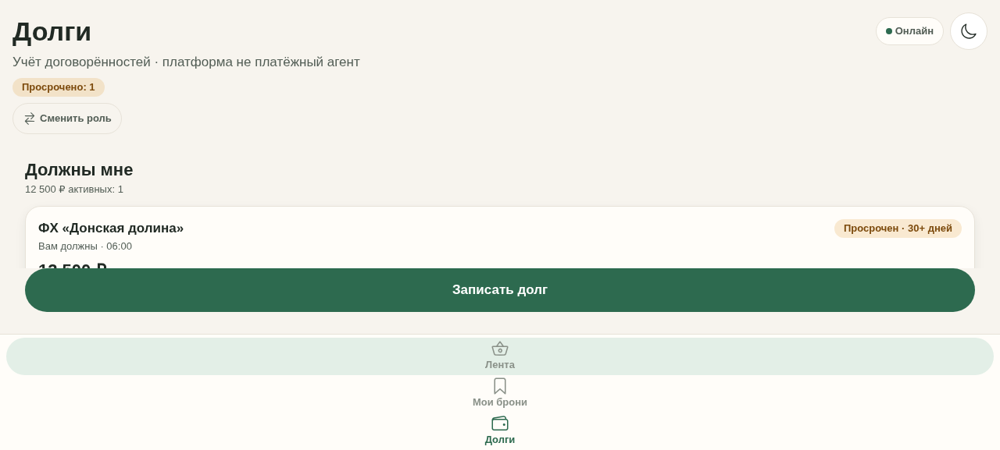     | 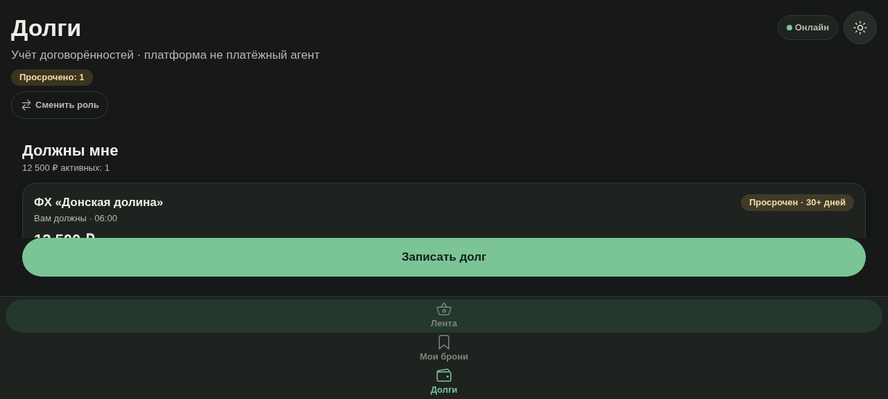          |
| Витрина продавца с виджетом долгов                                    | Витрина: «подтверждено сделок»                                           |
| 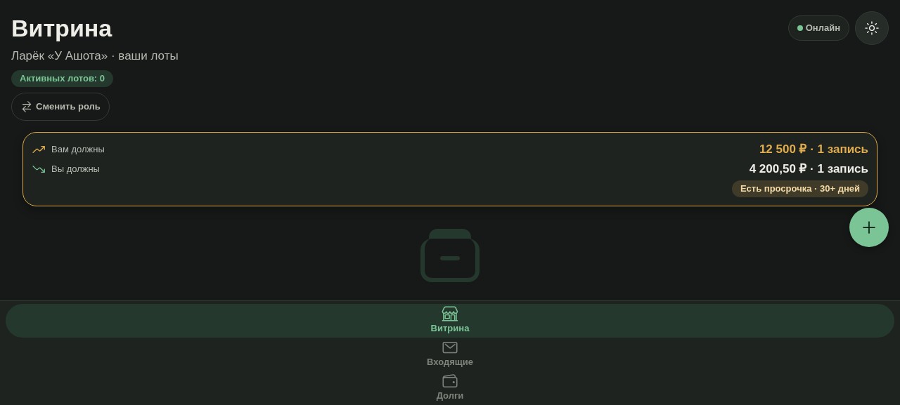  | 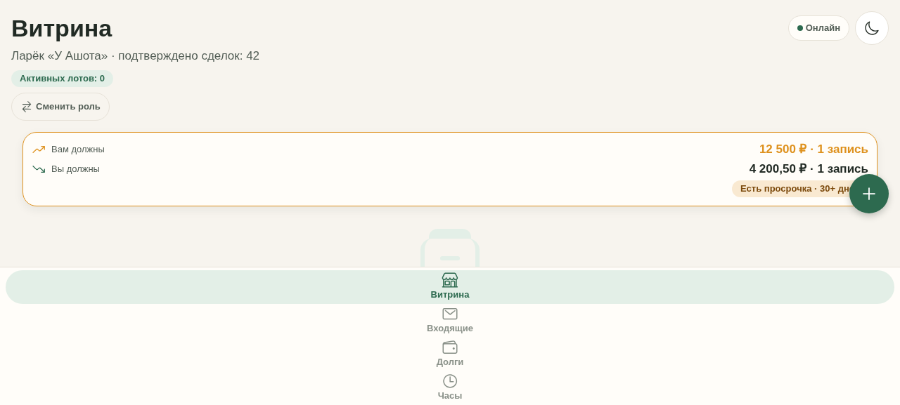     |
| Мои часы (светлая)                                                    | Мои часы (тёмная)                                                        |
| 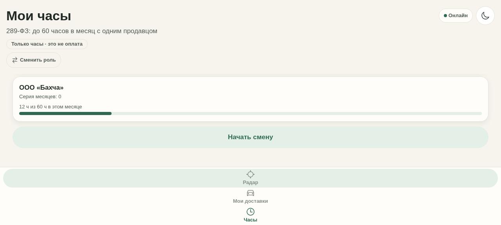      | 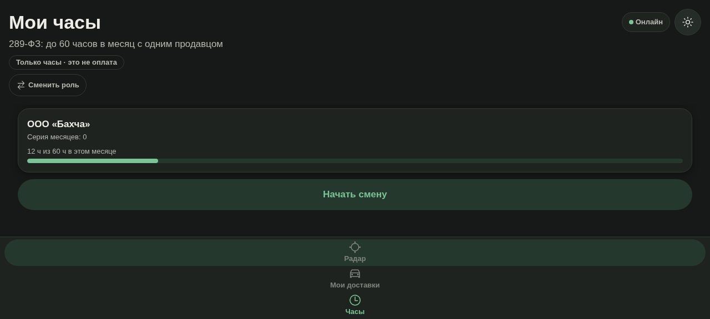           |
| Приёмка: модалка ok                                                   | Приёмка: предупреждение о споре (major)                                  |
| 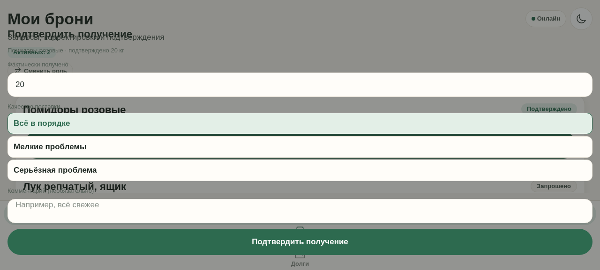 | 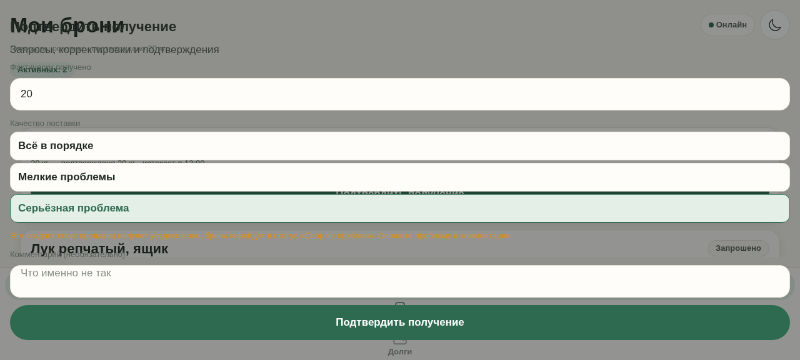 |

### curl-примеры v0.4.0

```bash
BASE=http://localhost:3000
TOKEN=<accessToken>          # POST /auth/request-code + /auth/verify

# ── Долги (ADR-010) ──────────────────────────────────────────────────
# записать «отпустил в долг» (идемпотентно: X-Idempotency-Key)
curl -s -X POST $BASE/debts \
  -H "Authorization: Bearer $TOKEN" \
  -H "X-Idempotency-Key: $(uuidgen)" \
  -H "Content-Type: application/json" \
  -d '{"debtorId":"<uuid>","amount":12500.50,"description":"Помидоры, 2 ящика"}'

# мои долги (обе стороны) и сводка для виджета
curl -s $BASE/debts?status=active -H "Authorization: Bearer $TOKEN"
curl -s $BASE/debts/summary   -H "Authorization: Bearer $TOKEN"

# погасить / спор / обоюдное разрешение / напомнить (кулдаун 24 ч)
curl -s -X POST $BASE/debts/<id>/settle   -H "Authorization: Bearer $TOKEN"
curl -s -X POST $BASE/debts/<id>/dispute  -H "Authorization: Bearer $TOKEN" \
  -H "Content-Type: application/json" -d '{"reason":"частично вернул"}'
curl -s -X POST $BASE/debts/<id>/resolve  -H "Authorization: Bearer $TOKEN"
curl -s -X POST $BASE/debts/<id>/reminder -H "Authorization: Bearer $TOKEN" \
  -w "\n%{http_code}\n"   # второй раз подряд → 429 DEBT_REMINDER_COOLDOWN

# ── Учёт часов 289-ФЗ (ADR-011) ──────────────────────────────────────
# начать/закончить смену с продавцом (водитель)
curl -s -X POST $BASE/work-hours/sessions \
  -H "Authorization: Bearer $DRIVER_TOKEN" -H "Content-Type: application/json" \
  -d '{"sellerId":"<uuid>"}'
curl -s -X POST $BASE/work-hours/sessions/<sessionId>/end \
  -H "Authorization: Bearer $DRIVER_TOKEN"

# мои пары за месяц и проверка пары перед заказом
curl -s $BASE/work-hours/me -H "Authorization: Bearer $DRIVER_TOKEN"
curl -s $BASE/work-hours/check/<driverId>/<sellerId> -H "Authorization: Bearer $TOKEN"
# заблокированная пара → {"blocked":true,...}; POST sessions → 409 WORK_PAIR_BLOCKED

# ── Приёмка (ADR-012) ────────────────────────────────────────────────
curl -s -X POST $BASE/bookings/<id>/confirm-delivery \
  -H "Authorization: Bearer $BUYER_TOKEN" \
  -H "X-Idempotency-Key: $(uuidgen)" \
  -H "Content-Type: application/json" \
  -d '{"receivedQuantity":15,"qualityFlag":"minor_issue","qualityNotes":"не хватило 5 кг"}'
# major_issue → статус disputed + уведомление продавцу
```

## Что нового в v0.3.1

- **Безопасность: отзыв refresh-токенов** —
  [ADR-008](docs/adr/ADR-008-refresh-token-revocation.md). Паттерн
  «Refresh Token Family + Rotation + Reuse Detection»:
  - каждый `/auth/refresh` **ротирует пару** токенов (старый jti →
    `used`, выдаётся новый); повторное предъявление старого = признак
    кражи → **вся семья отзывается**, 401 `TOKEN_REUSE_DETECTED`;
  - `POST /auth/logout` (204, идемпотентен) отзывает семью и кладёт
    jti access-токена в блэклист на остаток его ≤15 минут;
  - смена роли отзывает все сессии пользователя, кроме текущей;
  - Redis — источник решений (ключи `session:family:*` / `session:jti:*`,
    Lua-CAS для конкурентных refresh), Postgres `Session` — аудит;
    **fail-closed**: Redis недоступен → 401/503, а не «fail-open»;
  - rate limit `/auth/refresh` — 10/мин на IP;
  - мобильный клиент: logout вызывает сервер ДО локальной очистки,
    при `TOKEN_REUSE_DETECTED` — мягкое «Сессия завершена. Войдите
    снова» (без слова «кража»).
- **Визуальная полировка** —
  [ADR-009](docs/adr/ADR-009-visual-patterns.md):
  - «карточка раскрывается в экран»: морф фото карточки ленты в шапку
    детального экрана (spring ~300 мс); модалки — «листы» снизу с
    spring-физикой (`SheetModal`);
  - staggered-вход карточек (40 мс между, только первая отрисовка);
    бейджи статусов морфятся цветом 300 мс + cross-fade текста;
    «Синхронизация…» пульсирует 1→0.6→1 (2 с);
  - skeleton с **shimmer**: блик 45% ширины, 1.5 с loop, база
    surfaceElevated, блик +8% светлее;
  - пустые состояния с действием: «Пока тихо. Обновите или загляните
    позже» + «Обновить»; «Здесь появятся ваши заказы. Начните с ленты»
    - «В ленту»; иллюстрации появляются scale 0.9→1 (400 мс);
  - pull-to-refresh: haptic-«щелчок» в момент пересечения порога;
  - tab bar: cross-fade иконок + подпрыг 1→1.1→1, blur-подложка
    (expo-blur; на web — solid);
  - тактильная карта `packages/ui/haptics.ts`: tap / success / warning
    (+selection), троттлинг 150 мс — весь haptics приложения через неё;
  - тёмная тема: токен `scrim`, тени из `shadow[mode]`, shimmer и
    пустые состояния проверены в обеих темах.
- **Тесты**: 190+ unit (api + mobile + пакеты) и 30 e2e против реальных
  Postgres+PostGIS+Redis: ротация → повторное использование → мёртвая
  семья; logout → access и refresh невалидны; throttling refresh;
  booking-флоу не регрессировал.

### Скриншоты v0.3.1: до/после (светлая + тёмная тема)

| Лента — было (v0.3.0)                                          | Лента — стало (staggered, tab bar c blur)                                   |
| -------------------------------------------------------------- | --------------------------------------------------------------------------- |
| 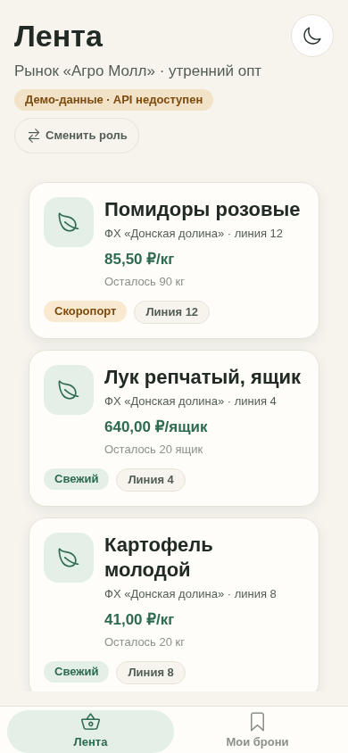        | 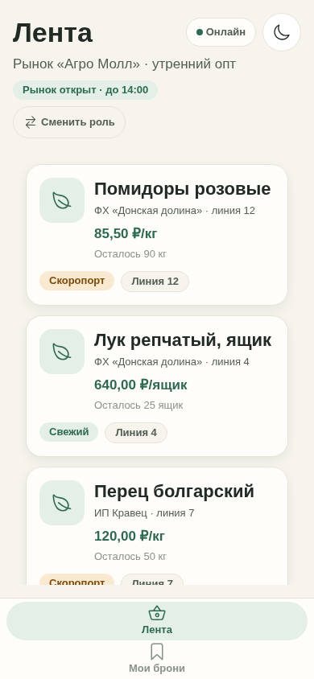        |
| 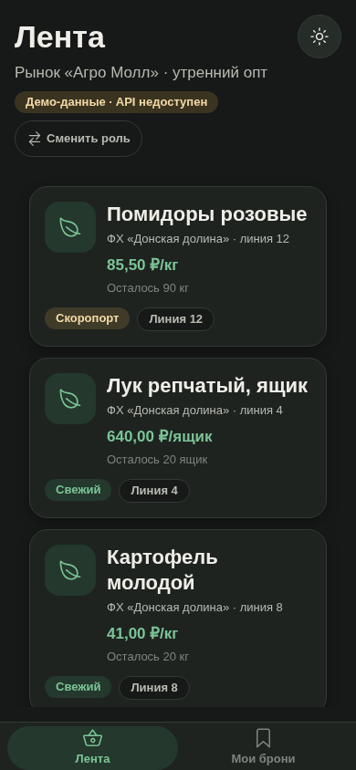 | 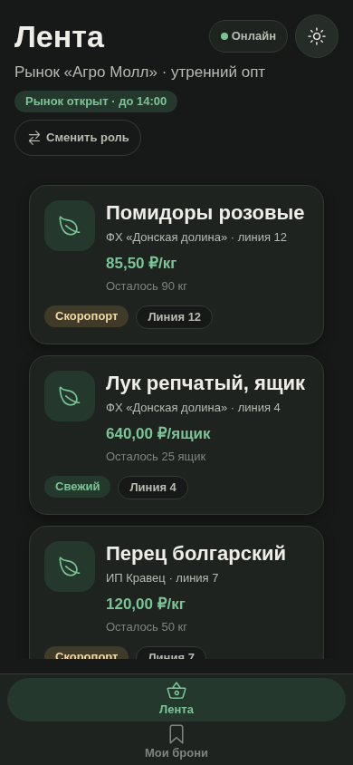 |

| Детальный экран (морф из карточки)                                           | Модалка-лист (spring снизу)                                               |
| ---------------------------------------------------------------------------- | ------------------------------------------------------------------------- |
| 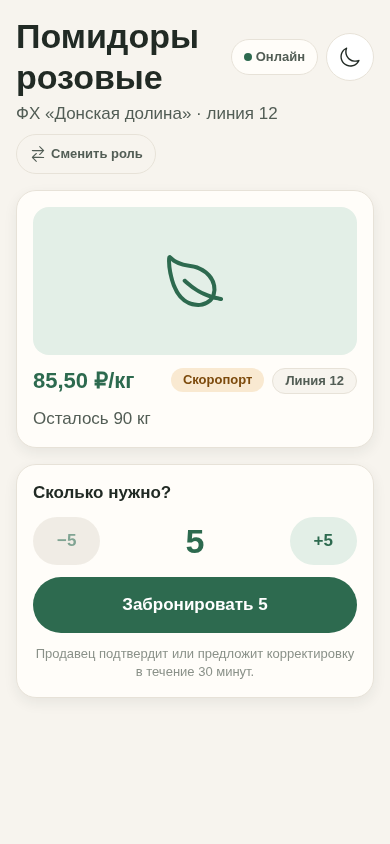 | 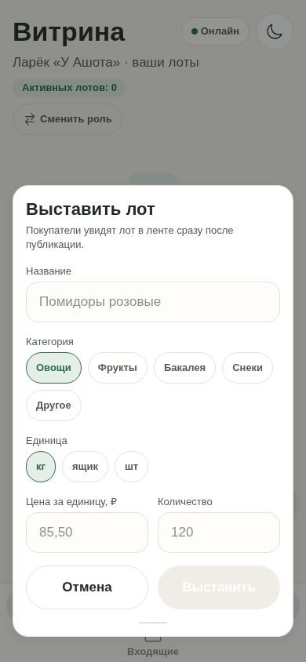 |
| 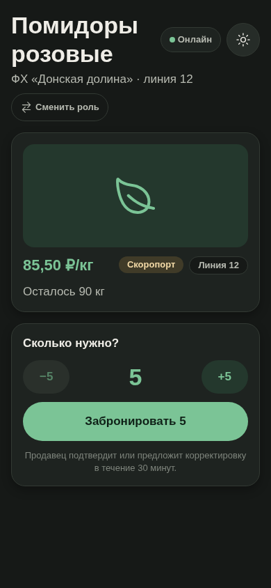   | 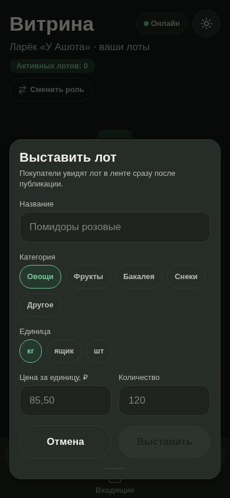   |

| Skeleton с shimmer                                                                   | Пустое состояние с действием                                                        |
| ------------------------------------------------------------------------------------ | ----------------------------------------------------------------------------------- |
| 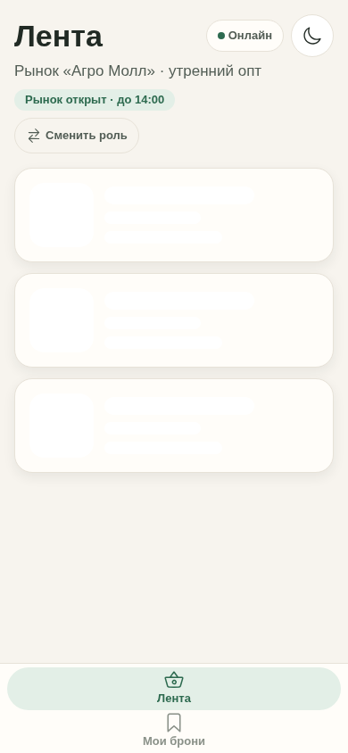 | 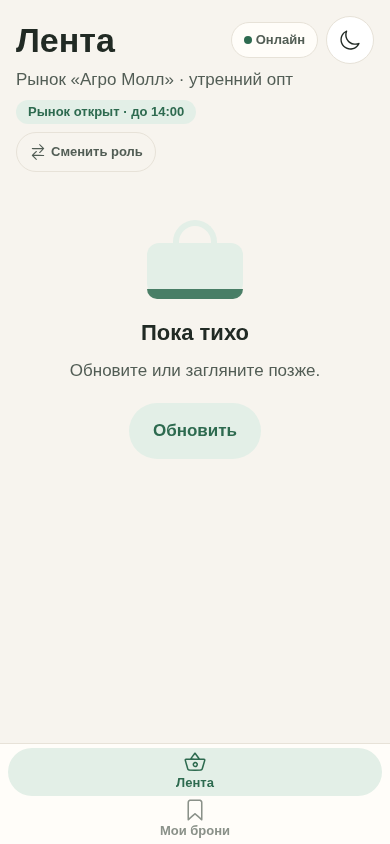 |
| 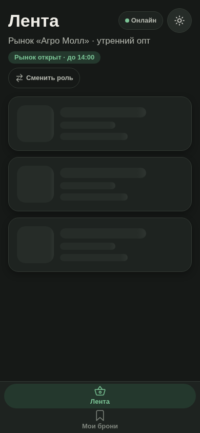   | 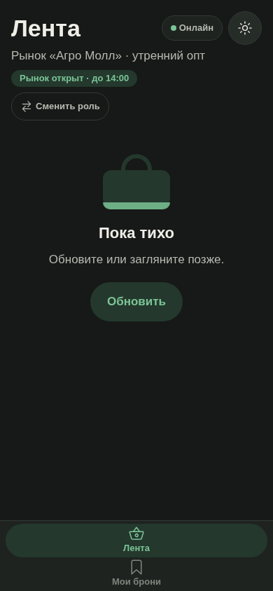   |

### Отзыв refresh-токенов вручную (curl)

```bash
# 1. Вход (dev-код «0000»)
curl -s -X POST localhost:3000/auth/request-code -H 'Content-Type: application/json'   -d '{"phone":"+79611230001"}'
curl -s -X POST localhost:3000/auth/verify -H 'Content-Type: application/json'   -d '{"phone":"+79611230001","code":"0000"}'
# → {"accessToken":"…","refreshToken":"R1",…}

# 2. Ротация: старый refresh → НОВАЯ пара
curl -s -X POST localhost:3000/auth/refresh -H 'Content-Type: application/json'   -d '{"refreshToken":"R1"}'
# → {"accessToken":"…","refreshToken":"R2"}     # R1 теперь «used»

# 3. Вор предъявил R1 повторно → семья отозвана
curl -s -X POST localhost:3000/auth/refresh -H 'Content-Type: application/json'   -d '{"refreshToken":"R1"}'
# → 401 {"code":"TOKEN_REUSE_DETECTED","message":"Сессия завершена. Войдите снова"}

# 4. Легитимный R2 тоже мёртв (семья отозвана целиком)
curl -s -X POST localhost:3000/auth/refresh -H 'Content-Type: application/json'   -d '{"refreshToken":"R2"}'
# → 401 "Сессия завершена"

# 5. Logout: доступ к /bookings с access → 401 (блэклист jti)
curl -s -X POST localhost:3000/auth/logout -H 'Content-Type: application/json'   -d '{"refreshToken":"R3","accessToken":"A3"}' -o /dev/null -w '%{http_code}
'
# → 204, повторный logout — тоже 204 (идемпотентен)
```

## Что нового в v0.3.0

- **Аутентификация: телефон + SMS-код → JWT** —
  [ADR-007](docs/adr/ADR-007-auth.md):
  - `POST /auth/request-code` — код в Redis (TTL 5 минут); в dev
    код-заглушка **«0000»** и печатается в лог; rate limit
    **1 запрос/мин на телефон** (трекер по телефону, не по IP — на рынке
    все за одним Wi-Fi);
  - `POST /auth/verify` — одноразовый код → `accessToken` (15 минут) +
    `refreshToken` (30 дней) + профиль; `POST /auth/refresh` — новый access;
  - `JwtAuthGuard` (Authorization: Bearer) полностью заменил заглушку
    `X-User-Id`; роль всегда перечитывается из БД — подделать нельзя,
    смена роли действует сразу;
  - `GET /users/me`, `PATCH /users/me/role` — роль хранится на сервере;
  - мобильный клиент: экран входа (маска +7 (_**) _**-**-**, 6 ячеек кода
    с авто-переходом, таймер повторной отправки 60 с, dev-подсказка),
    токены в `expo-secure-store`, авто-refresh при 401 (single-flight
    axios-интерцептор);
  - логи: маскированный телефон (`+7***1234`), без кодов и токенов.
- **Офлайн-ядро: outbox + идемпотентность + конфликты** —
  [ADR-006](docs/adr/ADR-006-offline-core.md):
  - локальная очередь мутаций в `expo-sqlite`: операции переживают обрыв
    сети и уходят с заголовком `X-Idempotency-Key` (uuid v4);
  - сервер: таблица `OutboxOperation` (уникальный `clientUuid`) +
    декоратор `@Idempotent()` — **дубль не создаёт вторую бронь**
    (реплей сохранённого результата); параллельный дубль → 409
    `IDEMPOTENCY_IN_PROGRESS`;
  - 6 состояний операции: pending / processing / retrying / conflicted /
    permanently_failed / completed; backoff 1с→2с→4с→8с→16с (максимум
    5 попыток); 5xx и сеть → retrying, прочие 4xx → permanently_failed;
  - все мутации броней идут ТОЛЬКО через outbox: создание, отмена,
    подтверждение, корректировка, принятие корректировки;
  - оптимистичный UI: бронь, созданная офлайн, сразу видна в «Моих бронях»
    с пометкой «Ждёт сети»;
  - конфликты не решаются молча: бизнес-409 → диалог
    **[Принять серверное] [Отменить локальную]**;
  - синхронизация: старт, сеть (NetInfo), передний план (AppState),
    pull-to-refresh, вручную;
  - индикатор в шапке: зелёная «Онлайн» / янтарная «Офлайн — сохраним» /
    пульсирующая «Синхронизация…»; тап → экран **«Очередь»** со всеми
    операциями и их состояниями;
  - выход из аккаунта очищает очередь — операции не утекают в чужую сессию.
- **Zod-валидация ответов API на клиенте**: схемы
  `ListingResponseSchema`, `BookingResponseSchema`, `UserResponseSchema`,
  `AuthResponseSchema`, `ErrorResponseSchema` (+ списковые) в
  `@agromoll/validation`; каждый ответ проверяется перед рендером —
  защита от «старый клиент + новый сервер», багов сериализации, частично
  MITM; лишние поля не отвергаются (passthrough); при провале —
  structured-лог с сырым ответом + мягкий EmptyState «Не удалось
  загрузить» вместо демо-данных.
- **Инфраструктура**: CI поднял Redis service-контейнер; e2e регистрируют
  пользователей через настоящий auth-флоу.
- **Тесты**: 130+ unit (api + mobile + пакеты) и 20+ e2e против реальных
  Postgres+PostGIS+Redis: полный auth-флоу (request-code → verify →
  /bookings → 401 → refresh), rate limit, дубль clientUuid, офлайн-сценарий
  «обрыв сети → восстановление».

### Скриншоты v0.3.0 (светлая + тёмная тема)

| Вход, шаг 1 — телефон                                            | Вход, шаг 2 — код из SMS                                         |
| ---------------------------------------------------------------- | ---------------------------------------------------------------- |
| 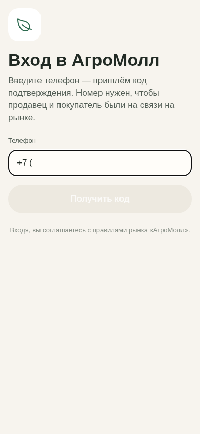 | 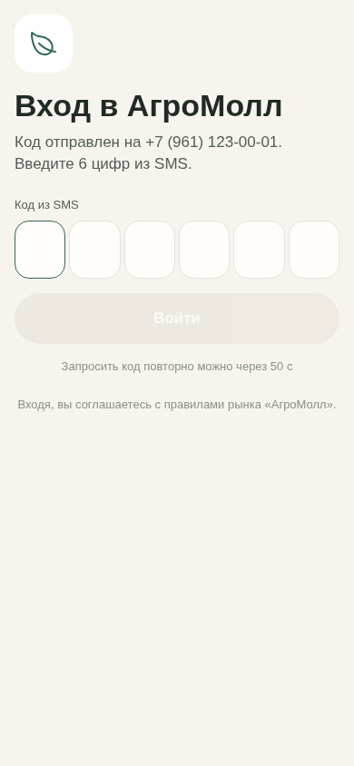 |
| 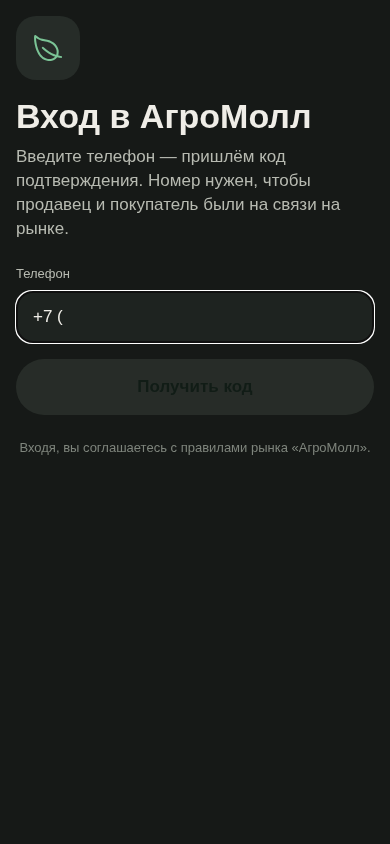   | 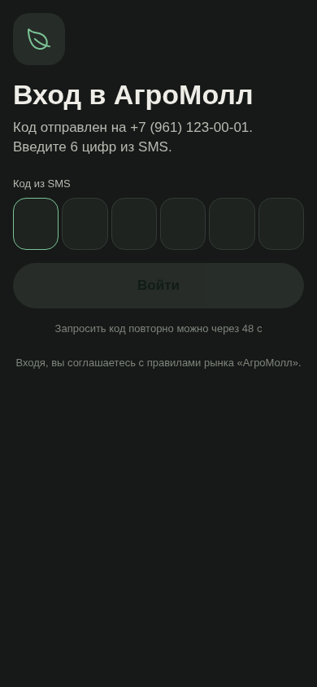   |

| Индикатор офлайна: 3 состояния                                     | Экран «Очередь»                                              |
| ------------------------------------------------------------------ | ------------------------------------------------------------ |
| 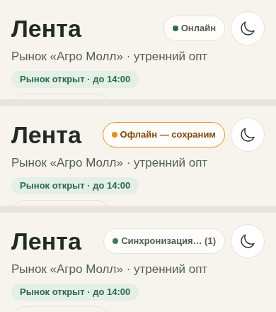 | 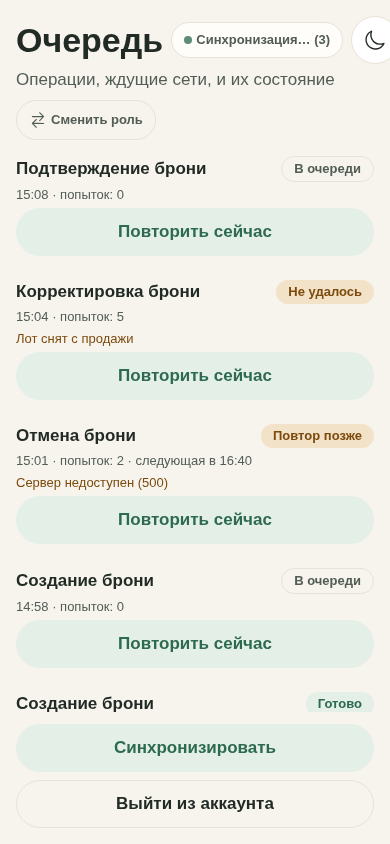 |
|                                                                    | 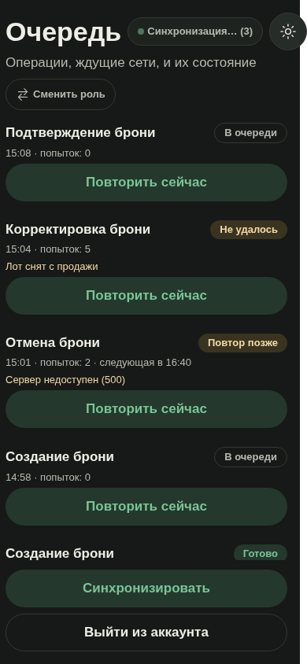   |

Скриншоты v0.2.0 (лента, брони, витрина, входящие) — в
[истории README](https://github.com/bolqor83-crypto/agromoll/blob/v0.2.0/README.md).

## Стек

| Слой     | Технологии                                                                                                                   |
| -------- | ---------------------------------------------------------------------------------------------------------------------------- |
| Mobile   | React Native (Expo SDK 52), Expo Router 4, TypeScript, Zustand, Reanimated 3, axios, expo-sqlite, expo-secure-store, NetInfo |
| API      | NestJS 11, TypeScript, Prisma 6, @nestjs/jwt, @nestjs/throttler, ioredis, pino, @nestjs/schedule (cron TTL)                  |
| БД       | PostgreSQL 16 + PostGIS 3.4, Redis 7 (SMS-коды: TTL 5 минут)                                                                 |
| Монорепо | pnpm workspaces + Turborepo, ESLint 9, Prettier, GitHub Actions                                                              |
| Пакеты   | `packages/types` (общие типы), `packages/validation` (zod: запросы + ответы), `packages/ui` (дизайн-система)                 |

## Структура

```
agromoll/
  apps/
    mobile/          — Expo-приложение: вход по телефону → выбор роли →
                       табы разделов (Покупатель: Лента/Мои брони;
                       Продавец: Витрина/Входящие; Доставщик: Радар/
                       Мои доставки), экран «Очередь», офлайн-ядро
                       (src/lib/outbox: service, sqlite-storage, transport)
    api/             — NestJS: /auth, /users, /listings, /bookings,
                       идемпотентность (@Idempotent), cron TTL, Prisma
  packages/
    ui/              — дизайн-система: токены, темы, Button, Card, Input,
                       Badge, Screen, Text, Icon, Skeleton, EmptyState,
                       TabBar, PullToRefreshScrollView
    types/           — общие типы (роли, листинги, брони, auth, телефон)
    validation/      — zod-схемы (запросы + схемы ответов API)
  docs/
    adr/             — ADR-001..007
    design/          — палитра и скриншоты (светлая/тёмная)
  docker-compose.yml — PostgreSQL + PostGIS, Redis
  turbo.json
  pnpm-workspace.yaml
```

## Быстрый старт

### Требования

- Node.js ≥ 20
- pnpm ≥ 9 (`corepack enable` или `npm i -g pnpm`)
- Docker (для БД; на CI проверяется автоматически)

### Запуск с нуля

```bash
# 1. Клонировать и установить зависимости
git clone https://github.com/bolqor83-crypto/agromoll.git
cd agromoll
pnpm install

# 2. Поднять PostgreSQL + PostGIS и Redis
docker compose up -d --wait

# 3. Скопировать переменные окружения
cp .env.example .env                  # токены и URL (в .gitignore)
cp apps/api/.env.example apps/api/.env

# 4. Сгенерировать Prisma-клиент и применить миграции
pnpm db:generate
pnpm db:migrate

# 5. Засеять демо-аккаунты (с телефонами!) и витрину
pnpm --filter @agromoll/api db:seed

# 6. Собрать пакеты (types, validation, ui)
pnpm build

# 7. Запустить всё
pnpm dev
```

После запуска:

- API: `http://localhost:3000/health` — healthcheck
- Mobile (Expo): `http://localhost:8081` — Metro-сервер (w — web, a — Android, i — iOS)

**Вход в приложении**: любой телефон в формате +7 999 XXX-XX-XX,
код — **«0000»** (dev-заглушка; в production будет SMS).
Демо-аккаунты сида: `+7 961 123-00-01` (покупатель),
`+7 961 123-00-02` (продавец), `+7 961 123-00-03` (доставщик).

### Как потрогать auth-флоу вручную (curl)

```bash
# 1. Запросить код (в dev всегда «0000», смотрится в лог API)
curl -s -X POST http://localhost:3000/auth/request-code \
  -H "Content-Type: application/json" \
  -d '{"phone": "+7 961 123-00-01"}'
# → {"expiresInSec":300}

# 2. Проверить код → токены + профиль
curl -s -X POST http://localhost:3000/auth/verify \
  -H "Content-Type: application/json" \
  -d '{"phone": "+7 961 123-00-01", "code": "0000"}'
# → {"accessToken":"…","refreshToken":"…","user":{…}}

TOKEN="полученный accessToken"
REFRESH="полученный refreshToken"

# 3. Профиль и смена роли
curl -s http://localhost:3000/users/me -H "Authorization: Bearer $TOKEN"
curl -s -X PATCH http://localhost:3000/users/me/role \
  -H "Authorization: Bearer $TOKEN" -H "Content-Type: application/json" \
  -d '{"role": "seller"}'

# 4. Обновить access-токен
curl -s -X POST http://localhost:3000/auth/refresh \
  -H "Content-Type: application/json" -d "{\"refreshToken\": \"$REFRESH\"}"

# 5. Rate limit: второй код на тот же телефон в минуту → 429
curl -s -X POST http://localhost:3000/auth/request-code \
  -H "Content-Type: application/json" \
  -d '{"phone": "+7 961 123-00-01"}' -w "\n%{http_code}\n"
```

### Как потрогать флоу брони вручную (curl)

```bash
# Два входа: покупатель и продавец (токены из /auth/verify выше)
BUYER_TOKEN="…"
SELLER_TOKEN="…"

# 1. Покупатель смотрит ленту
curl -s http://localhost:3000/listings | head -c 400

# 2. Покупатель бронирует (listingId из ленты) — идемпотентно:
#    X-Idempotency-Key можно не передавать (обычный путь)
curl -s -X POST http://localhost:3000/bookings \
  -H "Content-Type: application/json" -H "Authorization: Bearer $BUYER_TOKEN" \
  -d '{"listingId": "<LISTING_ID>", "requestedQuantity": 20}'

# 3. Продавец предлагает корректировку: 15 кг после 9:00
curl -s -X POST http://localhost:3000/bookings/<BOOKING_ID>/counter-offer \
  -H "Content-Type: application/json" -H "Authorization: Bearer $SELLER_TOKEN" \
  -d '{"offeredQuantity": 15, "pickupTime": "после 9:00"}'

# 4. Покупатель принимает
curl -s -X POST http://localhost:3000/bookings/<BOOKING_ID>/accept-counter \
  -H "Content-Type: application/json" -H "Authorization: Bearer $BUYER_TOKEN" -d '{}'

# 5. Дубль не создаёт вторую бронь: тот же Idempotency-Key — тот же ответ
KEY=$(uuidgen)
curl -s -X POST http://localhost:3000/bookings \
  -H "Content-Type: application/json" -H "Authorization: Bearer $BUYER_TOKEN" \
  -H "X-Idempotency-Key: $KEY" \
  -d '{"listingId": "<LISTING_ID>", "requestedQuantity": 5}'
curl -s -X POST http://localhost:3000/bookings \
  -H "Content-Type: application/json" -H "Authorization: Bearer $BUYER_TOKEN" \
  -H "X-Idempotency-Key: $KEY" \
  -d '{"listingId": "<LISTING_ID>", "requestedQuantity": 5}'
# → оба ответа содержат id ОДНОЙ и той же брони
```

Отдельные части:

```bash
pnpm --filter @agromoll/api dev        # только API
pnpm --filter @agromoll/mobile dev     # только mobile
pnpm --filter @agromoll/mobile dev:web # web-версия в браузере
```

### Проверки

```bash
pnpm lint        # ESLint по всем пакетам
pnpm typecheck   # TypeScript по всем пакетам
pnpm test        # unit-тесты (без БД)
pnpm --filter @agromoll/api test:e2e  # e2e: нужна БД + Redis (REDIS_URL)
pnpm build       # сборка пакетов, api и web-экспорт mobile
pnpm format      # Prettier
```

CI (`.github/workflows/ci.yml`):

- **quality** — lint/typecheck/unit/e2e/build; e2e идёт против
  service-контейнеров `postgis/postgis:16-3.4` и `redis:7-alpine`
  (миграции применяются перед прогоном);
- **stack** — `docker compose` целиком, миграции + проверка `prisma migrate diff`
  (миграции обязаны точно соответствовать `schema.prisma`) + PostGIS/Redis.

## Дизайн-система

Токены и компоненты живут в `packages/ui` (см. [ADR-002](docs/adr/ADR-002-design-system.md)):

- **Философия**: приложение используется в 4 утра, на улице, в спешке и перчатках —
  крупная типографика, тач-зоны от 48×48, минимум текста.
- **Цвета**: тёплый нейтральный фон (не слепит в темноте), тёмно-зелёный акцент,
  мягкий янтарный для срочности. Красный запрещён.
- **Тёмная тема** — с первого дня, следует системе + ручной переключатель на каждом экране.
- **Анимации**: 200–300 мс, spring-отклик на нажатиях (Reanimated), haptics на
  ключевых действиях.

Скриншоты и обоснование палитры: [docs/design/palette.md](docs/design/palette.md).

## Архитектурные решения

| ADR                                              | Тема                                                        |
| ------------------------------------------------ | ----------------------------------------------------------- |
| [ADR-001](docs/adr/ADR-001-tech-stack.md)        | Технологический стек (Expo, NestJS, Prisma, PostGIS, Redis) |
| [ADR-002](docs/adr/ADR-002-design-system.md)     | Дизайн-система: токены, палитра, тёмная тема, тактильность  |
| [ADR-003](docs/adr/ADR-003-monorepo.md)          | Монорепозиторий: pnpm workspaces + Turborepo                |
| [ADR-004](docs/adr/ADR-004-booking-model.md)     | Модель бронирования: статусы, резерв, TTL 30 минут          |
| [ADR-005](docs/adr/ADR-005-visual-components.md) | Визуальные компоненты v0.2.0: Skeleton, EmptyState, TabBar  |
| [ADR-006](docs/adr/ADR-006-offline-core.md)      | Офлайн-ядро: outbox, идемпотентность, конфликты             |
| [ADR-007](docs/adr/ADR-007-auth.md)              | Аутентификация: телефон + JWT, rate limit, безопасность MVP |

## Ветвление и коммиты

- `main` — стабильная ветка, push только после зелёного CI (через PR).
- `feature/*` — ветки задач.
- Коммиты — [Conventional Commits](https://www.conventionalcommits.org/ru/): `feat:`, `fix:`, `docs:`, `chore:`, `ci:` …

## Что дальше (v0.6.0 — план сохранён, ждёт следующей версии)

Крупный функциональный этап v0.6.0 (push-уведомления, арбитраж споров,
тайловая карта рынка, апелляции рейтинга) был запланирован до v0.6.1 и
**не отменён** — он отложен в пользу хотфикса прода и мобильного UX:

- Push-уведомления (брони, корректировки, TTL, доставка)
- Арбитраж споров и апелляции (решение рынка по спорным сделкам)
- Тайловая карта рынка (сейчас — схематичная SVG на web)
- Автоматический деплой API (публичный сервер, см. docs/DEPLOY.md)
- EAS Build + expo-updates
